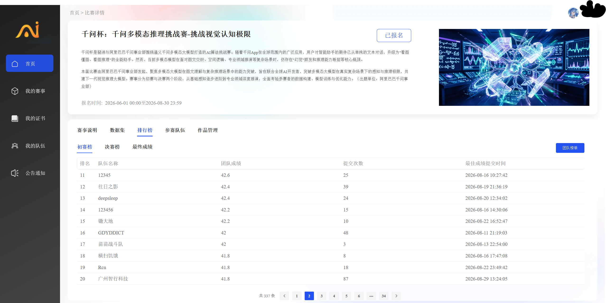
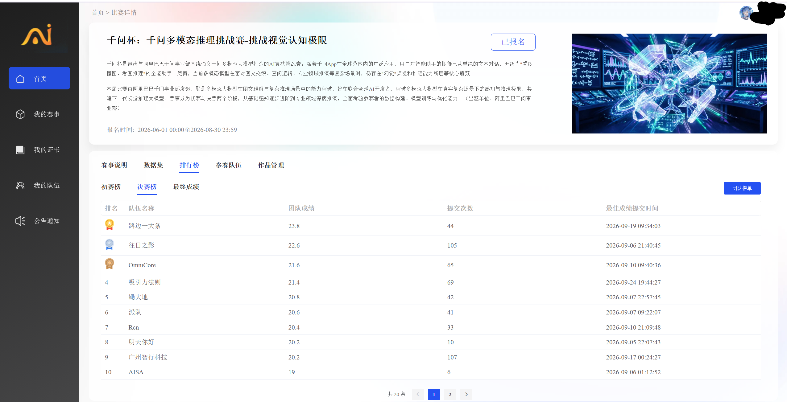
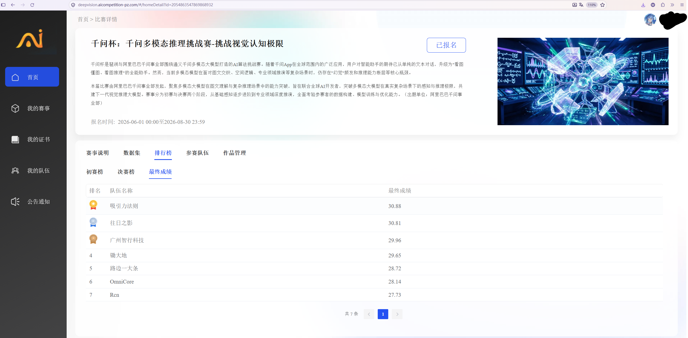

# 千问杯多模态推理大赛:教师蒸馏 SFT + GRPO 小剂量强化学习

<p align="center">
  <a href="README.md"></a>
  <a href="README_en.md"></a>
</p>

> **概述**:在 Qwen3.5-0.8B 多模态模型上构建「教师蒸馏 SFT 打底 + GRPO 小剂量强化学习精细校准」两阶段后训练流水线,覆盖数值推理、计数、空间推理、物理常识、感知、关联六维能力。核心产出是一组可迁移的实验方法论:奖励-评测口径逐字对齐、同权重 ZIP CRC 消融、统计化提交额度决策,以及「0.8B 小模型 RL 剂量-遗忘权衡」的系统刻画。
>
> **成绩**:初赛 **41.8 分**(500 题,赛道最高 43.6,**20/337** 压线晋级)→ 决赛线上评测 **20.2 分**(同口径 SFT 基线 18.2,RL 增益 **+2.0**),**最终成绩 9/20**;线上答辩 **第 3 名**(前 10 进答辩、2 队弃权,我们第 7 位出场),**获 2 万元奖金**。
>
> **怎么跑**:本仓库定位是**方案完整开源**——训练/导出脚本快照、真实训练日志与技术报告全部可见。训练在华为 Atlas 900 NPU + torch_npu 环境完成(脚本为该环境的服务器快照);评测集不公开,平台分无法本地复现。模型权重托管于 [Hugging Face](https://huggingface.co/huangxiu/Qwen3.5-0.8B-qwencup)(链接见[复现说明](#-复现说明))。

---

## 赛题简介

千问杯多模态推理大赛(阿里巴巴千问事业部发起,琶洲实验室联合主办,[官方赛事页](https://www.aicompetition-pz.com/topic_detail/24)):给定图文混合输入,模型须输出 `\boxed{答案}` 结构化答案。评测为官方六维 500 题(association / counting / numeric / perception / physics / spatial),平台分 = 正确题数 / 500 × 100(1 题 = 0.2 分),取历史最高。

赛制:初赛(SFT 阶段,2026-07-10 ~ 08-30,每天最多提交 2 次,337 支队伍,Top 20 晋级)→ 决赛(以初赛模型为起点做强化学习,09-05 ~ 09-25,每天最多提交 5 次)+ 线上答辩(10-12,前 10 名)。**赛事方不提供训练数据,数据须自备**——数据策略是核心竞争维度。最终评分 = 模型性能 65% + 技术方案 25% + 答辩 10%。

赛制硬约束(所有工程设计的出发点):

1. 必须以初赛提交模型为起点做 RL,不得更换起点;
2. 不得修改模型结构,不得引入其他预训练权重;
3. 评测集不公开,由赛事方统一评测,每日提交次数受限。

## 整体技术路线

```
阶段一 SFT(初赛,宽度优先)                阶段二 RL(决赛,深度优先)
Qwen3.6-27B 教师 (vLLM, TP=2, bf16)     初赛 v4 权重 (md5 合规门禁)
        │ 蒸馏 113,164 图 → 113,159 样本           │ GRPO 30 步小剂量
        ▼                                     ▼
精选配比 train_v4 (24,251 条)  ──────►  rlx30 (RAVEN 单维池 1,709 条)
2 epoch / seed 42 / all-linear             lr 1e-6 / β 0.2 / K 8 / seed 42
初赛 41.8 分                                决赛 20.2 分 (SFT 基线 18.2 → +2.0)
```

三条设计原则:**SFT 负责宽度、RL 负责深度**(0.8B 模型容量有限,RL 只做精细校准,避免灾难性遗忘);**口径对齐**(训练奖励与评测脚本逐字一致,无 reward hacking 空间);**额度理性**(每次提交是带噪声的测量读数,用统计方法分配)。

## 阶段一:教师蒸馏 SFT(初赛 41.8)

### 蒸馏管线(113K 样本)

| 项 | 值 |
| --- | --- |
| 教师模型 | Qwen3.6-27B,本地 vLLM 推理(bf16,TP=2) |
| 候选图像池 | 第一轮 CLEVR-Math / ChartQA / ScienceQA / VSR(113,164 张);round2 补蒸追加 GQA / PlotQA / PhyX / FSC-147——两轮共 8 个公开数据集,详见 [数据工程](docs/data-engineering.md) |
| 产出 | **113,159 条** LLaVA 风格样本(完成度 99.996%),单轮 `<image>` + 中文提示 + `\boxed{}` 答案,与平台评测口径同构 |
| 吞吐 | 每批 64 图、并发 16,~0.85 条/s |
| 工程可靠性 | 54 小时无人值守,**35 次 NPU ERR99999 崩溃全部自愈**(主循环 + keepalive 30min + 外部监督三层看护),有效吞吐 75% |

蒸馏产出类别分布:spatial 44,231(39.1%)/ numeric 28,731(25.4%)/ counting 27,203(24.0%)/ perception 12,376(10.9%)/ physics 618(0.5%)——physics 天然稀缺,是后续弱维画像的根因。

### SFT 精选与训练(train_v4)

- **三级数据漏斗的第一级压缩**:113,159(蒸馏全量)→ **24,251**(SFT 精选,丢弃率仅 0.524%);token 长度 p50=325 / p90=1156 / max=2041,max_len=2048 全量通过。
- **配方**:LoRA r16 / α32,2 epoch,lr 1e-4,有效 batch 16,max_len 2048,all-linear,seed 42,单卡 NPU。
- **变量隔离设计**:v4 与 v3 配置完全相同、仅数据规模扩大——配置侧收益(+3.4)已吃满后,验证数据侧再 +0.4。
- **训练日志**(见 [sft/logs/](sft/logs/)):3,032 步一次跑完无中断,loss 6.07 → 2.03。

### 初赛成绩

**41.8 分**(500 题 qwen-plus judge),赛道最高 43.6,第 20 名压线晋级决赛。

## 阶段二:GRPO 小剂量 RL(决赛 20.2,9/20)

### Reward 设计:与评测逐字对齐(核心)

```
R = acc + 0.5 × fmt  (结构上等效于三档离散奖励)
  ├─ 抽出 \boxed{} 且归一化后与参考答案相等 → 1.0
  ├─ 抽出 \boxed{} 但答案错误               → 0.05(格式地板,保住格式梯度)
  └─ 抽不出 \boxed{}                        → 0.0
```

答案提取器 = `rfind("\boxed{")` + 括号深度计数,与官方评测脚本**逐字一致**;归一化(去空白/标点/全半角 + lower)与平台判分完全同口径 ⇒ 训练奖励即评测目标,没有 reward hacking 空间。另设零梯度防护(监控组内奖励全同的步占比)与答案类型自洽率审计。

### rlx30 训练配方

| 设计项 | 取值 | 设计意图 |
| --- | --- | --- |
| 框架 | TRL 0.29.1 GRPOTrainer + vLLM 在线采样 | 免 critic,显存友好,数值稳定 |
| 组大小 K | 8 | K16 实测双倍有效学习量反而 −3.25 分,K8 是甜点 |
| 步数 | **30 步(小剂量)** | 剂量轴实测峰值(见下) |
| 学习率 / KL β | 1e-6 常数 / 0.2 | 限制权重位移,锚定初赛起点防遗忘 |
| 有效 batch | 8 prompts/步,总采样 240 prompts | 30 步只消耗池中 14% 样本,避免过拟合池捷径 |
| 数据池 | RAVEN 九宫格抽象推理 1,709 条(单维高浓度) | 六维画像中 association 0.212 为第二弱维、奖励信号 100% 可覆盖,且与决赛官方考察维度「抽象图形规律(九宫格 IQ 测试)」直接对齐 |
| 合规门禁 | 起点权重 md5 逐字节校验固化进前置脚本 | 规则硬要求:禁中间 SFT、禁换起点 |
| 训练成本 | 端到端 7.5 分钟(212s = 7.1s/步) | 消融迭代成本极低 |

### 决赛成绩

- v4 在决赛评测口径下的基线为 **18.2 分**(两阶段评测集构成不同,分数不可直接比较)。
- **rlx30 = v4 + GRPO 30 步:20.2 分**(四次投递 19.6 / 20.2 / 19.6 / 20.0,μ=19.85,σ=0.29),**决赛最终成绩 9/20**,RL 同口径增益 +2.0。
- 答辩:前 10 名进入线上答辩,2 队弃权,我们第 7 位出场——**答辩排名第 3 名,获 2 万元奖金**。

## 排行榜(成绩公示)

参赛队名:**广州智行科技**。三个赛程的官方排行榜截图,完整披露晋级进程:

**初赛榜 —— 41.8 分,20/337 压线晋级 Top 20**



**决赛线上评测榜 —— 20.2 分,第 9 名**



**终榜 —— 决赛最终成绩 9/20;线上答辩第 3 名(前 10 进答辩、2 队弃权,我们第 7 位出场)**



## 实验发现

### 1. RL 剂量轴非单调,30 步是峰

| 步数 | 10 | 20 | **30** | 50 | 60 |
| --- | ---: | ---: | ---: | ---: | ---: |
| 平台分 | 19.2 | 15.2 | **19.6–20.2** | 17.8 | 16.8 |

超过 30 步后平台分随剂量单调下降——过大剂量导致灾难性遗忘(机制见发现 3)。

> 轶事:rlx30 的 30 步本身就是一次事故的产物——原计划 40 步,第 35 步存盘时磁盘爆满,救回 `checkpoint-30` 导出(同 seed/同数据序下与独立 30 步 run 逐 bit 等价)。事后剂量轴消融证明 30 步恰为峰值,详见 [grpo/README.md](grpo/README.md)。

### 2. 同权重 ZIP CRC 消融:不重训的因果结论

四个提交包共享同一份权重(`model.safetensors` 逐字节一致,zip 逐成员 CRC 审计确认仅 `generation_config.json` 一件不同)——**不重训即可获得推理侧因果级结论**:

| 消融轴 | 唯一变量改动 | 平台分 | Δ | 结论 |
| --- | --- | ---: | ---: | --- |
| 基准 | 平台默认采样(同包四投 μ) | 19.85 | — | 温度曲线峰值恰在平台默认 |
| 解码 | greedy(do_sample=false) | 16.8 | **−3.0** | 采样解码是性能支柱 |
| 解码 | temperature 1.15 / top_p 0.95 | 16.6 | **−3.05** | 默认即峰值 |
| 生成长度 | +max_new_tokens 2048 | 19.8 | −0.05 | 零效果(反向佐证权重逐字节同) |
| 预处理 | longest_edge 16,777,216 → 1,638,400 | 16.4 | **−3.2** | 56.7% 评测图丢失约 90% 像素,细节受损 |

⇒ 采样解码白送约 3 分,一切推理侧参数保持平台默认。

### 3. 0.8B 的灾难性遗忘铁律:池内学习量与平台分强反相关

| 包 | 池内平均奖励(学习量) | 平台分 |
| --- | ---: | ---: |
| rlx30(abstract) | **0.088**(几乎没学) | **20.2** |
| ph1(physics) | 0.843 | 18.8 |
| h7(counting) | 0.644 | 16.4 |
| h9k16(K16) | 有效学习 3× | 16.6 |

四个独立实验点连线:池内学习量越大,平台分越低。K16 消融给出机制佐证:池内奖励峰值 0.287→0.581(学习效率翻 3 倍)、零梯度步占比 51%→27%,平台分反而 −3.25——0.8B 模型在 RL 中学到的是数据池的捷径规律,占用本已有限的容量,代价是其他维度的遗忘。

数据池轴同向佐证:abstract 单维(RAVEN 1,709)20.2 > physics 单维 18.8 > 六维均衡 17.8 > counting 单维 16.4 > 六维补全 16.8——**池与隐藏评测集的分布匹配度是决定因素,不是覆盖面**。

⇒ 小模型的 RL 最优策略 = 极小剂量锚定:让 RL 做精细校准,而非大规模策略更新。

### 4. 平台噪声与统计化额度决策

- 同一包 4 次投递 σ_judge ≈ 0.29;跨 artifact 判读阈值 1.3–1.6。
- 13 个历史读数 μ=17.54、σ=1.57 ⇒ 新配方 P(>20.2) ≈ 1.1%,复投最优 artifact ≈ 11.3%/发(40 万次蒙特卡洛模拟)⇒ **决策 = 复投最优 artifact,把额度留给统计上更优的选择**。

### 增益分解(每一层都有单变量证据链)

| 版本 | 平台分 | 增量 | 证据 |
| --- | ---: | --- | --- |
| v4-SFT(决赛口径基线) | 18.2 | SFT 蒸馏底座 | 初赛 41.8 |
| **rlx30 = v4 + GRPO 30 步** | **20.2** | **RL +2.0** | 起点 md5 门禁保证唯一变量 |
| + 推理侧保持平台默认采样 | (greedy 掉 3.0) | 采样 +3.0 | 同权重 ZIP CRC 消融 |

## 目录结构

```
Qwen-Cup-Multimodal-RL/
├── README.md / README_en.md
├── docs/
│   ├── finals-technical-report.md   # 决赛完整技术方案(全部实验数据的权威来源)
│   ├── data-engineering.md          # 数据工程:来源/合成/清洗/配比/RL 池/奖励-评测对齐
│   └── preliminary-sft-notes.md     # 初赛 v4 脚本包说明(版本溯源与复现命令)
├── sft/                             # 阶段一:教师蒸馏 SFT(初赛 v4)
│   ├── scripts/                     # 训练/看门狗/数据合并/导出 5 脚本(服务器快照·脱敏)
│   └── logs/                        # 真实训练与导出日志(3,032 步,loss 6.07 → 2.03)
└── grpo/                            # 阶段二:GRPO RL(决赛 rlx30 训练/导出/打包 + 全超参快照)
```

## 🔄 复现说明

本仓库**不提供端到端一键复现**,原因与边界如下:

- **评测侧**:评测集(六维 500 题)不公开,平台分只能由赛事方评测产生;仓库内全部平台分均为官方评测读数。
- **训练侧**:训练在 Atlas 900 NPU + CANN + torch_npu 环境完成。[sft/scripts/](sft/scripts/) 为该环境服务器快照的**脱敏副本**(仅内部路径与解释器路径替换为占位符,逻辑未改动),配套 [sft/logs/](sft/logs/) 为对应真实训练日志。GRPO 侧已**完整入库**:三步流水(`01_run_rlx30.sh` 训练 → `02_export_rlx30.sh` 导出打包 → `03_pack_flat_zip.py` 校验)、训练主程序 `grpo_apply_v14.py`(含与官方评测逐字一致的奖励函数实现,附 09-15/09-18 两版)及其余原件,md5 与 MANIFEST 逐一核对一致;复现流程与已知坑见 [grpo/README.md](grpo/README.md)。训练日志与 09-13 训练当日版仅存服务器。
- **数据侧**:三级数据漏斗(113K 蒸馏合成 → 24,251 SFT 清洗精选 → 1,709 RL 定向浓缩)的来源、合成、清洗、配比与奖励-评测对齐详见 **[docs/data-engineering.md](docs/data-engineering.md)**;完整实验数据见[技术报告](docs/finals-technical-report.md) §4–§6。数据文件本身未随仓库分发。
- **权重**:

  | 模型 | 说明 | 下载 |
  | --- | --- | --- |
  | v4(初赛 41.8) | Qwen3.5-0.8B + LoRA 合并导出,bf16 | [权重 `preliminary/`](https://huggingface.co/huangxiu/Qwen3.5-0.8B-qwencup/tree/main/preliminary) |
  | rlx30(决赛 20.2) | v4 + GRPO 30 步,zip md5 `37f81f331ed2ca75fc87d1045ab1a1b3` | [权重 `finals/`](https://huggingface.co/huangxiu/Qwen3.5-0.8B-qwencup/tree/main/finals) |

## 致谢

- 赛事主办方提供评测平台与算力环境
- [Qwen](https://github.com/QwenLM) 系列模型(基座 Qwen3.5-0.8B 与教师 Qwen3.6-27B)
- [TRL](https://github.com/huggingface/trl) · [vLLM](https://github.com/vllm-project/vllm) · [PEFT](https://github.com/huggingface/peft)
- CLEVR-Math / ChartQA / ScienceQA / VSR + GQA / PlotQA / PhyX / FSC-147(蒸馏候选池,两轮)· RAVEN(RL 数据池)

## License

- **本仓库(代码、脚本、文档)**:[MIT License](LICENSE)——可自由使用、修改与分发。
- **模型权重**(Hugging Face 上的 v4 / rlx30)为 Qwen3.5-0.8B 的微调衍生权重,遵循 [Qwen 原始模型许可协议](https://huggingface.co/Qwen)。
