# 官方示例数据集解析(训练数据格式样例)

**简体中文** | [English](official-sample-data_en.md)

> **来源**:千问杯官方发布的示例数据集(训练数据格式样例,1,000 条 + 1,009 张图;压缩包 132 MB,解压约 142 MB)。本页仅抽样 **11 条**用于格式讲解(≈0.9 MB),完整数据包不入库。

## 1. 这是什么

官方发布的 SFT 训练数据格式样例,展示"一条多模态训练样本长什么样":每条记录是 **Qwen 对话模板的预渲染分段流**,并带好损失掩码。题目内容在图片里,文本侧只有简短指令(甚至没有);参考答案是一段完整 CoT,以 `\boxed{}` 收尾。

**与本仓库训练数据的关系**:我们自建的 `train_v4.jsonl`(24,251 条)用的是 **SWIFT 格式**(`messages` / `images` 键,见 [sft/scripts/merge_train_v4.py](../sft/scripts/merge_train_v4.py)),由训练框架渲染成同样的对话模板——**内容等价、序列化不同**;两者在「答案以 `\boxed{}` 收尾」上与平台评测提取口径一致。

## 2. 一条样本的解剖

顶层字段:`trace_id`(1–1000)、`_source_file`(样例切自 `vl_solve_problem_with_images.jsonl`)、`message[]`(六段,顺序固定):

| 段类型 | 内容 | need_mask(损失掩码) |
|---|---|---|
| `bos` | 空串(标记位) | ✅ 掩码 |
| `user_prefix` | `<\|im_start\|>user\n` | ✅ 掩码 |
| `user_content` | `<\|vision_start\|><\|image_pad\|><\|vision_end\|>` 视觉占位与问题文本(**顺序不固定**:既有文本在后,也有题干先于占位出现) + `<\|im_end\|>`;`image_filenames` 挂在本段 | ✅ 掩码 |
| `assistant_prefix` | `<\|im_start\|>assistant\n` | ✅ 掩码 |
| `assistant_content` | CoT 解题过程 + `\boxed{答案}` | ❌ **唯一参与训练损失** |
| `eos` | `<\|endoftext\|>` | ✅ 掩码 |

完整一条(trace #1,交替加减数列求和)见 [sample_record_trace1.json](assets/official-sample/sample_record_trace1.json)。

## 3. 抽样 gallery(11 / 1000)

| trace | 图 | 题面 / 答案 |
|---|---|---|
| #1 | 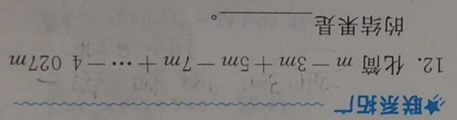 | 交替加减数列求和;问题「解答题目」;ans `\boxed{-2014m}` |
| #60 | 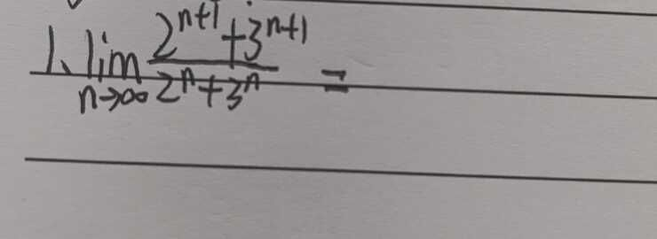 | 数列极限计算;问题「解答题目」;ans `\boxed{3}` |
| #784 | 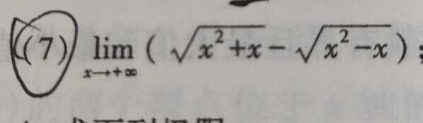 | 分子有理化求极限;问题「解答题目」;ans `\boxed{1}` |
| #917 | 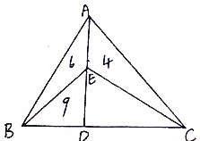 | 三角形面积模型(几何);题干在文本侧(「如图,在△ABC中…」)且**先于图占位出现**;ans `\boxed{6}` |
| #985 | 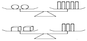 | 天平平衡应用题(完整题干在文本侧,图为天平示意图;3 KB 极小图真实存在);ans `\boxed{5}` |
| #846 | 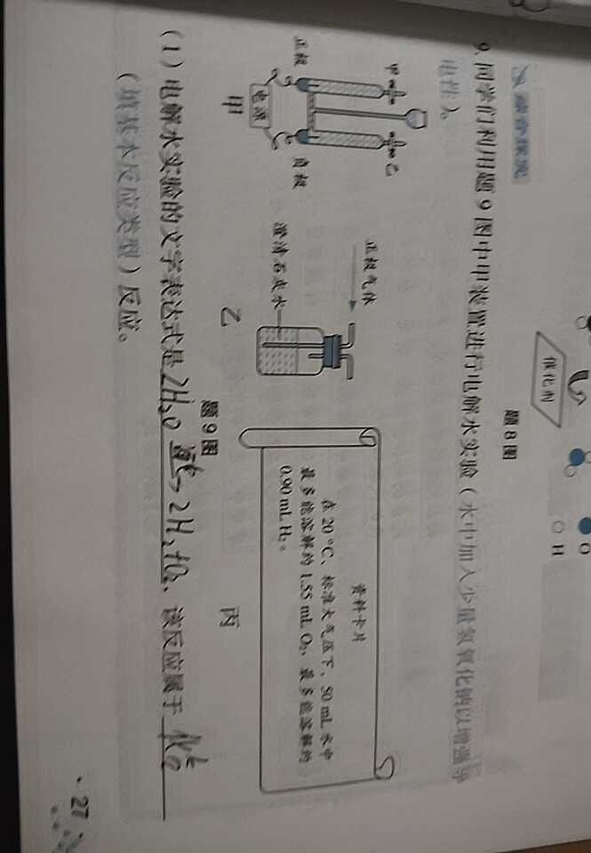 | 电解水 + CO₂ 化学方程式多小问(共 6 个 `\boxed{}`,按 rfind 提取口径末个答案为 `\text{铂}`) |
| #311 | 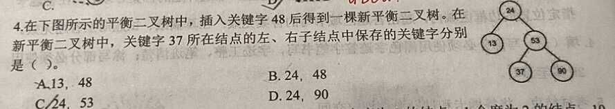 | 二叉排序树插入(数据结构单选);ans `\boxed{C}` |
| #490 | 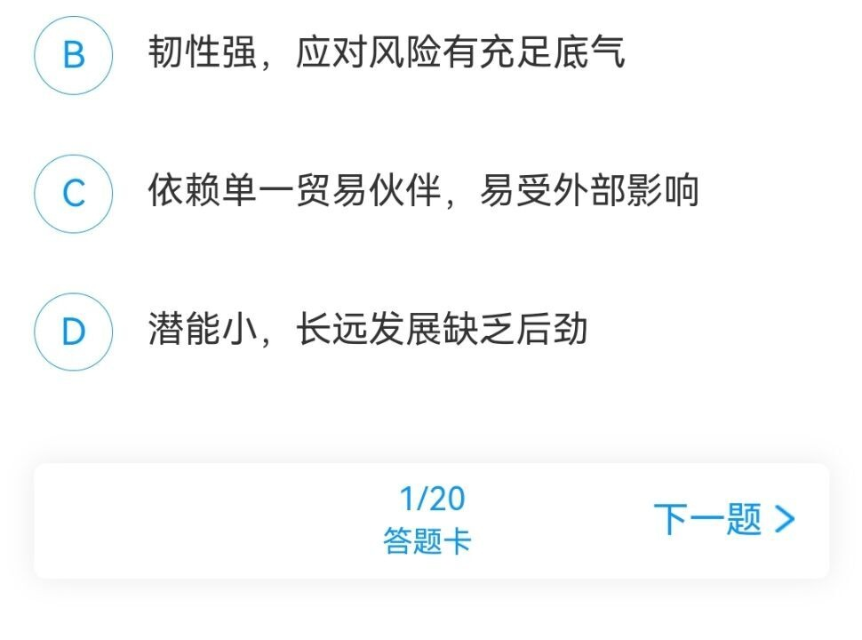 | 经济常识单选(通识);ans `\boxed{B}` |
| #652 | 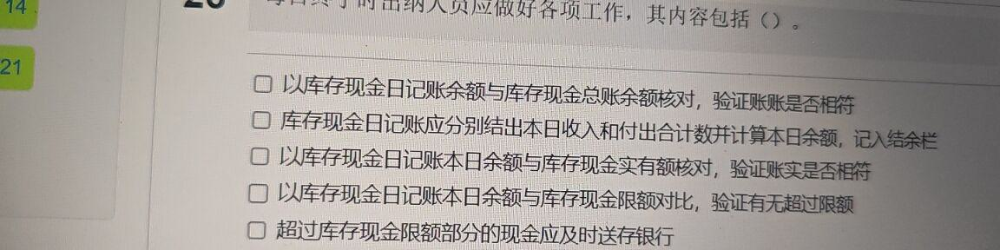 | 出纳日清实务多选(财会);ans `\boxed{①②③④⑤}` |
| #294 | 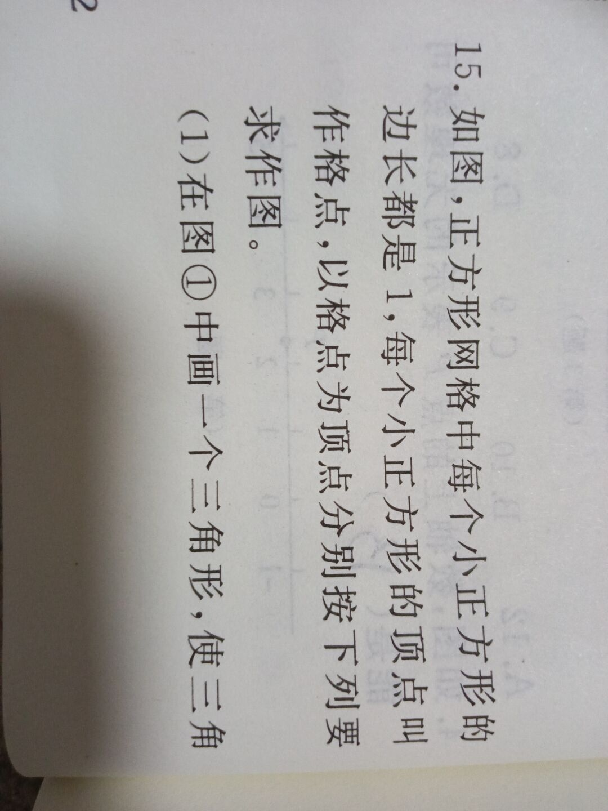 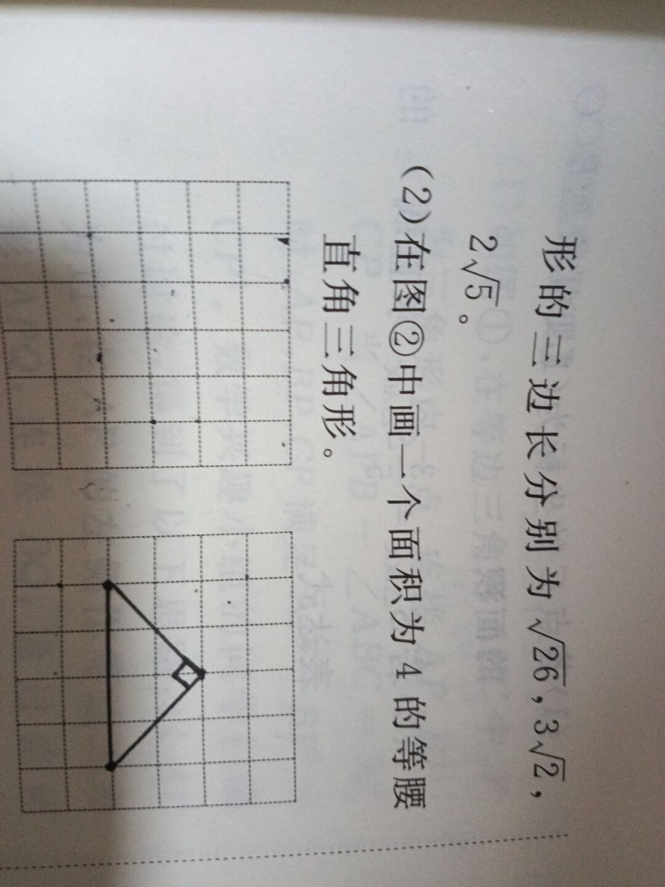 | 网格作图题(**双图样本**,样例集含 8 条多图、最多 3 图);ans 为坐标序列 |
| #35 | 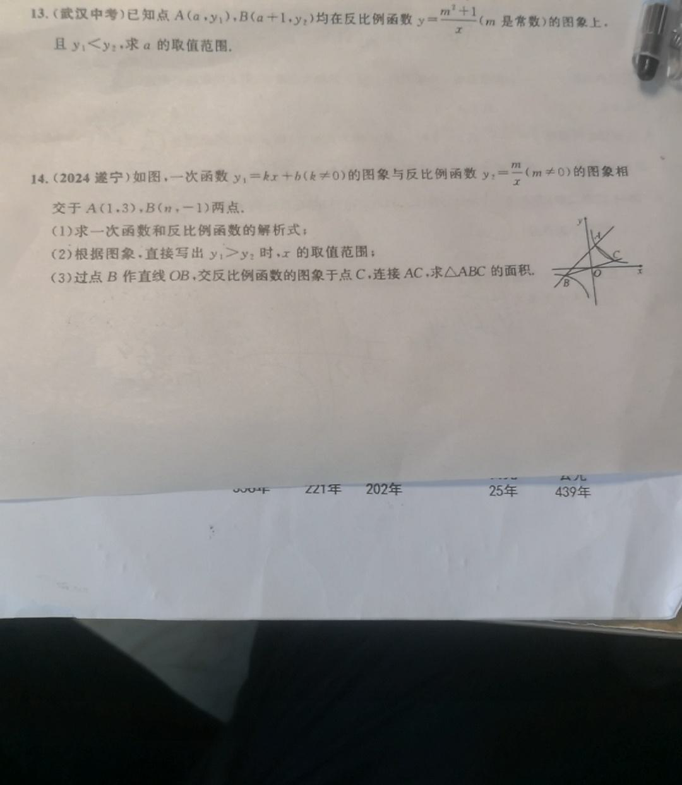 | 反比例函数综合;**纯图无文本问题**;ans `\boxed{-1<a<0}` |

## 4. 全量统计(1,000 条)

| 维度 | 数据 |
|---|---|
| 问题文本 | 「解答题目」346 · 「帮我分析一下图片内容」241 · **纯图无文本 43** · 「解答图中题目」40 · 「帮我分析一下图片」23 · 「这道题的答案是什么？」20 · 「这道题的正确答案是什么？」18 · 「答案」13 · 「题目答案是什么？」12 · 共 **237 种**不同写法 |
| `\boxed{}` 覆盖 | **1000 / 1000 均含 `\boxed{`**;其中 3 条(#65 / #208 / #439)末尾 boxed 括号不闭合,提取需兜底 |
| 答案形态(按 rfind 末个 boxed) | 整数/小数 390,选项字母占比次之(A–D 单选即 109);其余:比例(`1:1`、`3:5`)、坐标、区间(`-1<a<0`)、化学方程式、代数式(`-2014m`)、序号(`①②③④⑤`)等 |
| CoT 长度 | 104–9,059 字,均值 679 |
| 图片 | 0.6 KB–1.5 MB,共 140.8 MB;两类形态:宽条题目截图(≈900×240)与整页/实拍照片(≈1080×1440);多图样本 8 条(最多 3 图),1,009 张全被引用、零孤儿零缺失 |
| 内容 | 以学科解题为主:数学分析(极限/数列/函数)、几何、数据结构、通识常识、财会实务、化学等 |

## 5. 官方样例也是"生数据"(与本仓库清洗管线的对接)

抽样核对发现的原始问题——也是真实训练数据工程的输入现实:

1. **14 个图片扩展名拼成 `.jepg`**;
2. 43 条**纯图无文本问题**——下游加载器必须自适配空指令;且文本与图占位**顺序不固定**(#917 题干先于占位出现);
3. 3 条末尾 `\boxed{}` **括号不闭合**(#65 / #208 / #439)——提取器必须按括号深度计数并做不闭合兜底;
4. 问题文本共 **237 种**不同写法——提示词归一化有必要;
5. #35 的 assistant 输出**以裸 JSON `{"content":…` 开头**——上游教师输出泄漏直通样例;
6. #490 的 CoT 中出现繁体「強」——简繁/全半角混排真实存在。

这些正是 [数据工程](data-engineering.md) §3 清洗与验真、§5 奖励-评测答案归一(全半角折叠)所处理的对象。

## 6. 入库与引用说明

- 本目录仅含 12 张图(11 条样本,#294 为双图)+ 1 条完整 JSON(≈0.9 MB);完整数据包(解压约 142 MB)不入库;
- 版权归赛事官方所有,此处出于格式讲解目的少量引用;转载请注明来源。
